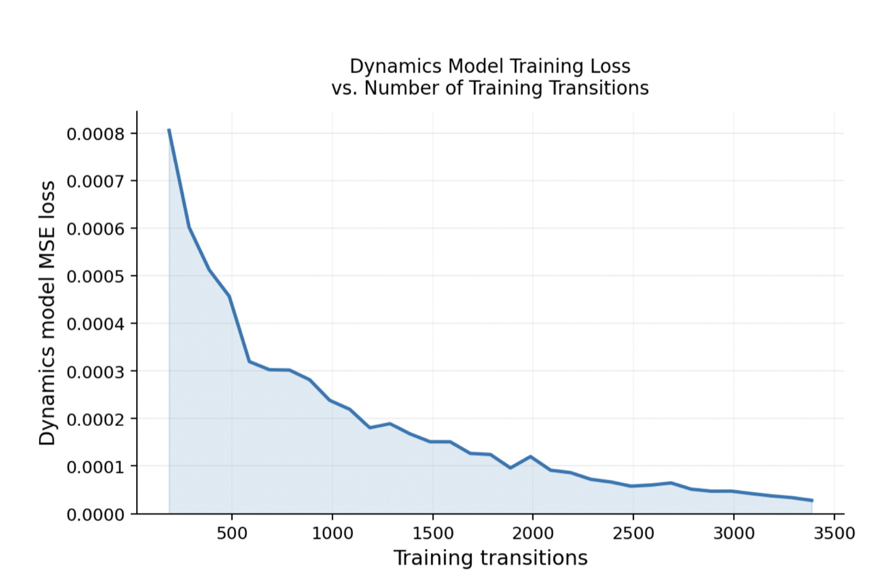
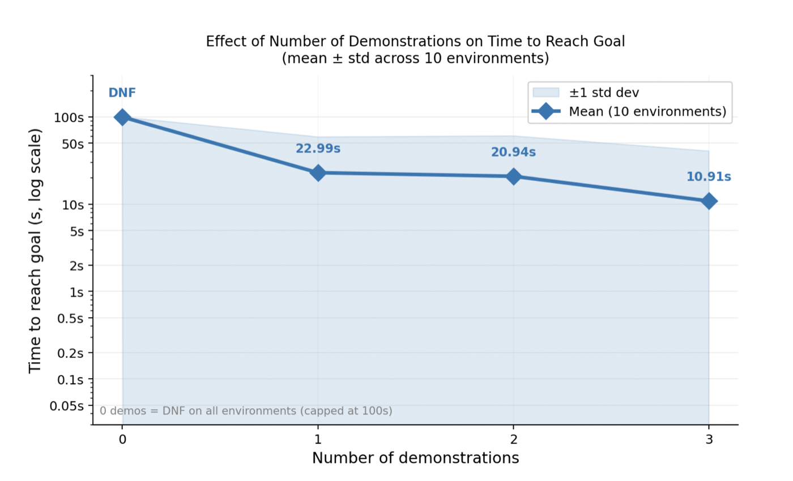

# Robot Learning: Budget-Constrained Goal Reaching With Behavioural Cloning And MPC


A robot controller that learns to reach a goal line in a simulated environment with very little data and a limited budget. It combines **behavioural cloning** from three expert demonstrations, a **learned dynamics model** that is retrained online, a **goal-progress score** learned from observations, and **model predictive control (MPC)** at test time. Robot Learning module, MSc Computing (Artificial Intelligence & Machine Learning), Imperial College London, 2026.

**Author:** [Parnian Fazel](https://github.com/parnianf)

## The task

The robot moves in a 2D environment and has to cross a goal line as fast as possible. It receives observations rather than its true position, so it has no direct measure of progress and must learn one. Training is limited by a **monetary budget** that is spent on wall-clock time, environment steps, resets and expert demonstrations (a demonstration is the most expensive item). Once training ends, the robot is timed on how quickly it reaches the goal line.

## Method

All of it is in [`robot.py`](robot.py); the hyperparameters are at the top of the file.

**Training**

1. **Demonstrations:** three expert demonstrations of 30 steps each are requested first.
2. **Behavioural cloning:** an MLP policy (3 hidden layers of 128 units, `tanh` output scaled to the maximum action) is trained on the demonstrations with a mean-squared-error loss.
3. **Exploration:** while collecting transitions the cloned policy is executed with Gaussian noise that decays from 50% to 5% of the maximum action, which diversifies the data and stops the dynamics model from overfitting to a narrow part of the state space. The environment is reset periodically.
4. **Dynamics model:** an MLP predicts the *change* in observation from the current observation and action. It is first trained on the demonstrations and then retrained every 100 new transitions, following the model-based RL loop: collect data, update the model, plan, repeat.
5. **Goal-progress score:** the correlation between each observation dimension and the negative distance to the goal gives non-negative weights `w`, so that the score `R(o) = wᵀo` is a dense reward without access to the true state. It is calibrated from the demonstrations first and then recalibrated online from the distances returned by the environment.

**Testing (closed-loop MPC with a 3-step horizon)**

At every step the robot picks an action in three stages:

1. the **cloned action**, if the dynamics model predicts that it improves the score;
2. otherwise a **random-shooting** action (30 random and 5 biased candidates rolled out through the learned model), if that predicts more progress;
3. otherwise a **gradient-based planner** that backpropagates through the differentiable dynamics network to refine the cloned action.

If the score has not improved for 15 steps, the gradient planner is also used to optimise a longer escape action sequence.

## Results

**Dynamics model.** The one-step prediction error drops from about 8·10⁻⁴ to 3·10⁻⁵ as transitions are collected, so the iterative model-learning loop works. The small spikes appear when new data from unvisited regions enters the replay buffer, and the loss then recovers quickly (single run, seed 2).



**Number of demonstrations.** Time to reach the goal, averaged over 10 environments (runs that do not finish are capped at 100 s):

| Demonstrations | 0 | 1 | 2 | 3 |
|---|---|---|---|---|
| Mean time to goal | did not finish in any environment | 22.99 s | 20.94 s | **10.91 s** |



Without demonstrations the robot never reaches the goal: the cloned policy gives a goal-directed starting point that MPC alone cannot find from random exploration. Performance improves with more demonstrations, and three gave the best mean, so that is the setting in `robot.py`. The spread across environments is large (shaded band), so the differences between one and two demonstrations should not be over-interpreted.

## Repository structure

```
├── robot.py             # controller: replay buffer, BC policy, dynamics model, goal-progress scorer, planners, Robot class
├── requirements.txt
└── results/             # figures used in this README
```

## Running it

`robot.py` implements the `Robot` interface (`training_action`, `receive_transition`, `receive_demo`, `testing_action`) of the module's simulation framework (environment, demonstrator, graphics and main training/testing loop), which is not part of this repository. To run the controller, place `robot.py` in the framework folder and start the framework's main script.

```bash
pip install -r requirements.txt
```
